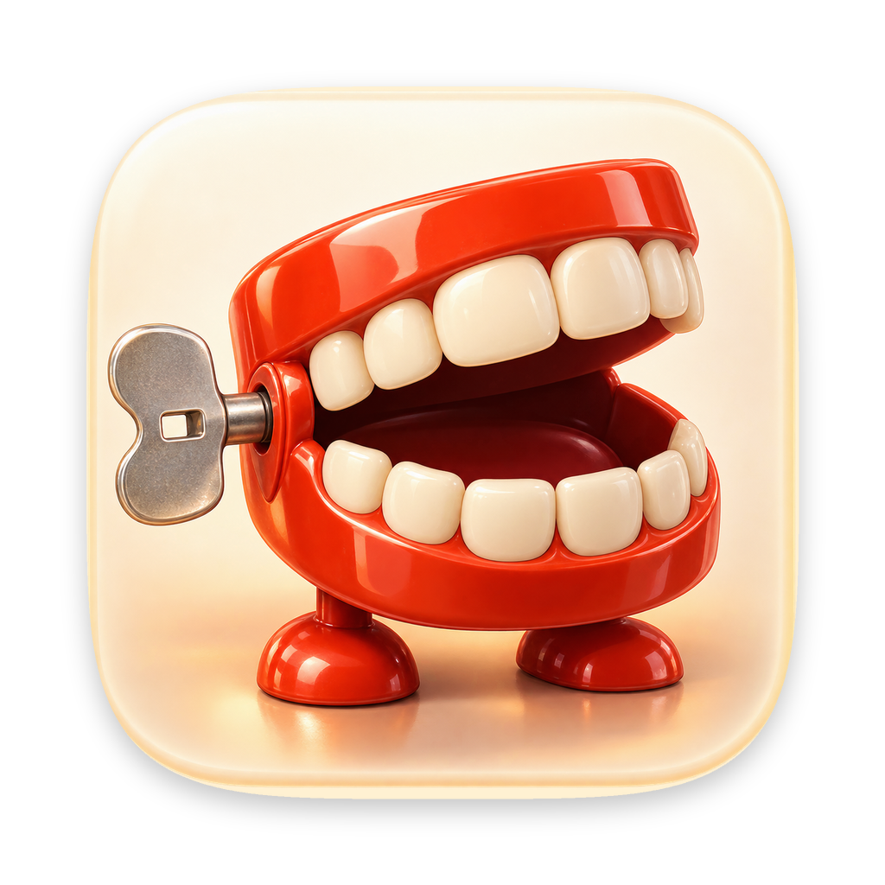

<p align="center">
  
</p>

<h1 align="center">yap</h1>

<p align="center">
  dictation for macos. hold fn, talk, let go, and it's pasted wherever your cursor is.<br>
  it uses the speech model that comes with macos, so nothing leaves your mac and it's free.
</p>

<p align="center">
  
</p>

i wrote it to replace wispr flow, which sat on 1.3 gb of ram and about 5% cpu whether i was talking or not. yap sits on about 0.1 gb and only does anything while you're talking.

## install

```sh
brew tap 0xdeafcafe/yap https://github.com/0xdeafcafe/yap
brew install --cask yap
```

it'll want the microphone (to hear you) and accessibility (to see fn and press ⌘V). quit wispr flow first, or both will paste.

## use

| | |
| --- | --- |
| hold `fn` | talk, let go to paste |
| double-tap `fn` | hands free, tap again to paste |
| `fn` + another key | cancel, so fn+← still works |
| `esc` | cancel |

or click the blob to start and click it again to paste. hold ⌘ and drag it to move it to another edge.

while you talk, a small bubble sits just under your cursor, sized to the text you're typing in, the way macos's own dictation does, and gets out of the way as your words land. where an app doesn't say where its cursor is (most terminals), the panel opens out of the blob instead, and settings › general can keep it there always.

yap takes fn over while it's running, so the emoji picker and apple's dictation don't open. your setting comes back when you quit.

the menu bar icon has your last few transcripts and opens settings (⌘,), where you'll find your history, the language you dictate in (any apple's speech model knows, from british english to brazilian portuguese), a few app icons, and opt-in formatting ("new line", "bullet", "code npm test end code").

it learns your words. when you start talking it reads the window you're in and takes the names and odd words from it (anything with capitals in the middle, digits, or that the dictionary doesn't know), plus whatever an app like rush sends it, and tells the speech model to listen for them. if it then hears something that's one letter or so off exactly one of them, like "reddis" with "Redis" on screen, it fixes it and underlines it in the panel and in history so you can see it did, and after a few times it learns the swap for good. it never touches an ordinary word, and it doesn't keep what it read. you can also fix a name after it pastes, or in history, and it'll spell it right next time. words you keep deleting, like "basically", get dropped. settings › words shows what it's learned and suggests names from your history that the dictionary doesn't know. you can add your own to `~/.config/yap/words.txt` too, one per line, `btw => by the way` to swap a phrase, or `drop: basically` to drop a filler.

privacy: transcripts are kept for 30 days, then deleted. if you already had older history, yap tells you how much would go first and lets you keep it forever. recordings are off unless you turn them on. settings › privacy shows how much is kept and lets you stop saving what you say, change how long things are kept, or delete the lot. nothing leaves your mac.

## in other apps

yap says what it hears, as it hears it, on `~/.config/yap/live.sock`: one line of json per change, with the words it's sure of, the ones it's still guessing, how loud you are, and the app it'll paste into. only your user can connect. [rush](https://github.com/0xdeafcafe/rush) uses it to show the dictation in its message box while you talk.

an app can tell yap which words to listen for by writing a line back, when it connects and whenever its words change:

```json
{"context":{"app":"com.mitchellh.ghostty","words":["Redis","rushd","LangWatch"]}}
```

`app` is the bundle id of the terminal it runs in, or `""` if it doesn't know. yap uses the words when it's pasting into that app (or any app, for `""`), keeps only the latest line from each connection, and forgets it when the connection closes. up to 200 words; lines over 64 kib and anything else are ignored.

## is it any good

i ran 40 of my old wispr flow dictations (about 10 minutes) through each engine on an m1 max.

| engine | error rate | wait after you stop | ram |
| --- | --- | --- | --- |
| parakeet v3 (mlx) | 7.4% | 0.5 s | 1.1 gb |
| wispr flow (cloud) | 7.4% | 0.6 s | 1.3 gb, all the time |
| **apple speechtranscriber (yap)** | **8.6%** | **0.9 s** | **0.1 gb** |
| whisper large-v3-turbo | 11.1% | 1.4 s | 0.9 gb |

nobody hand-checked these, so each one's scored against what the others agreed on, which is fine for comparing them but isn't an exact accuracy.

wispr flow cleans up filler with an llm. apple's on-device model deleted real words when i tried it ("i really don't like", "looks terrible"), and qwen3 4b wanted 2.9 gb and another 1.5 s, so yap uses plain rules: um, uh, repeated words, and a comma'd "like" or "you know". none of them took out a real word on the same 40 clips.

on top of the rules, settings › general › cleanup has three levels. light is only those rules. medium, the default, has apple's on-device model fix punctuation and grammar a sentence at a time while you talk, and if it drops a word you said, yap pastes its own version of that sentence instead. heavy also drops what you take back ("send it to john, no wait, sarah" pastes "send it to sarah") and turns lists into bullets. medium and heavy need apple intelligence; without it, you get light.

## build

needs macos 26 and xcode's command line tools.

```sh
./bundle.sh && open Yap.app
Yap.app/Contents/MacOS/Yap --selftest     # the rules and the tests
Yap.app/Contents/MacOS/Yap --demo bottom  # play the panel on the bottom edge
Yap.app/Contents/MacOS/Yap --settings     # open the settings window on its own
```

every dictation is logged to `~/Library/Logs/Yap/dictations.jsonl`, for as long as settings › privacy says (30 days unless you change it). audio's only kept if you turn it on there.

to release, bump the versions in `Info.plist` and push a `v<version>` tag. the workflow signs, notarises and publishes it.

it leans on two private apis, one to stop fn opening the emoji picker and one for the hand cursor. both need replacing before it could go on the app store.
